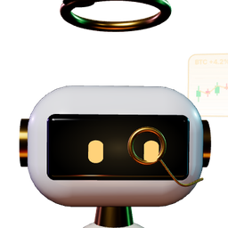
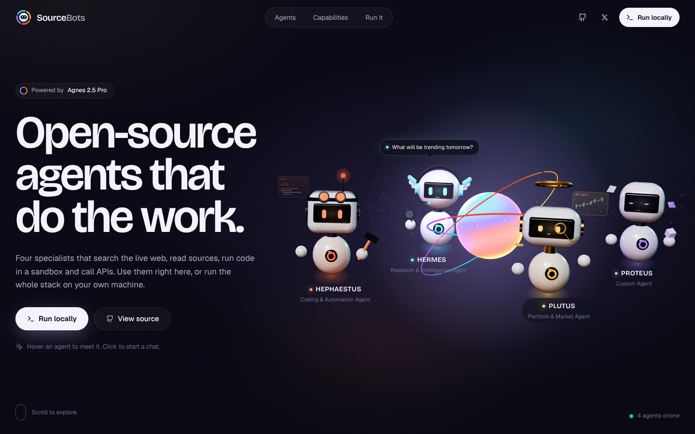
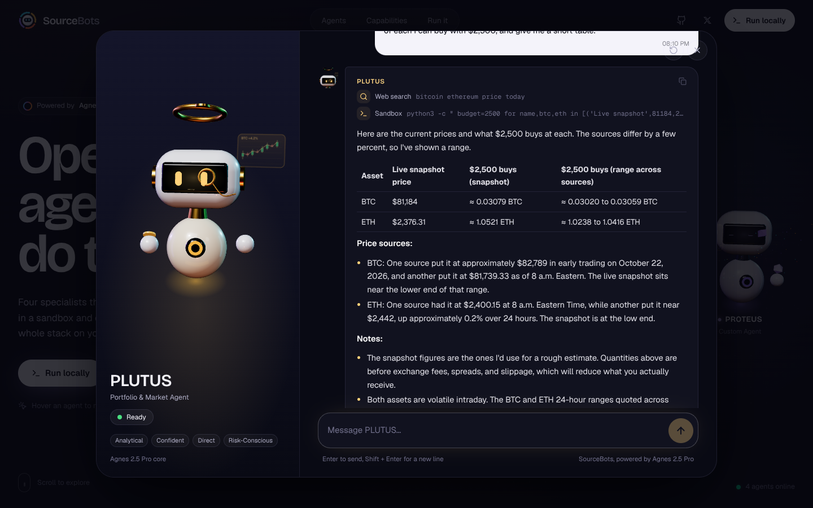
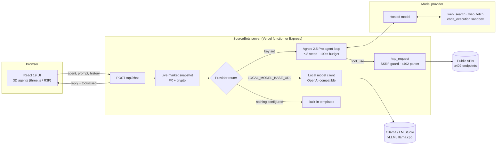
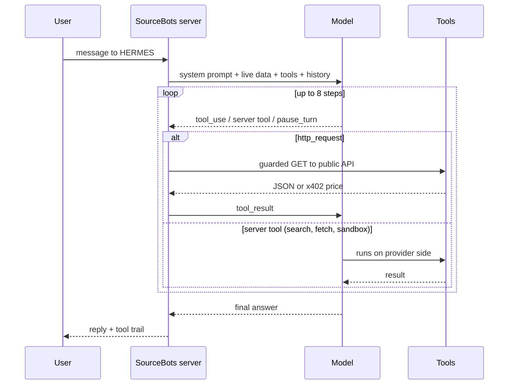

<div align="center">


# SourceBots

**Four AI agents that search the web, read pages, run code in a sandbox and call APIs.<br/>Use them in the browser or run the whole stack on your own machine.**

[](LICENSE)
[](.nvmrc)
[](tsconfig.json)

[Live demo](https://agnes123.vercel.app) · [Quick start](#quick-start) · [Run fully local](#run-fully-local-with-an-open-weight-model) · [Architecture](#architecture) · [API](#api-reference) · [Roadmap](#roadmap)


</div>

---

## Why SourceBots

Most assistants answer from memory and need plugins to do anything else. SourceBots agents **act**: each answer can
involve searching the live web, opening sources, running Python in an isolated sandbox and calling public APIs, and
the chat shows every step they took.

- **Agents, not a chatbot.** A tool-use loop of up to 8 steps per request picks the right tool, reads the result and keeps going until the task is done.
- **Hosted or fully local.** Use the hosted agent runtime with tools, or point SourceBots at an open-weight model in Ollama, LM Studio, vLLM or llama.cpp and keep everything on your machine.
- **Built for the agent economy.** Agents understand [x402](https://www.x402.org/) `402 Payment Required` responses and report exactly what an API would charge.
- **Safe by construction.** Outbound calls are SSRF-guarded, code runs in an isolated container, payments are never sent automatically. See [SECURITY.md](SECURITY.md).
- **Open source.** MIT licensed, 50+ tests, CI on every push.

## Meet the agents

| | Agent | Role | Ask it to… |
|:-:|---|---|---|
|  | **PLUTUS** | Portfolio & market agent | price an asset, compare currencies, stress-test a portfolio, explain a macro move |
|  | **HEPHAESTUS** | Coding & automation agent | write and *run* a script, debug a stack trace, build a scraper, automate a workflow |
|  | **HERMES** | Research & intelligence agent | track a narrative across the web, fact-check a claim, separate FACT from SIGNAL from SPECULATION |
|  | **PROTEUS** | Custom agent | become any expert you describe: lawyer, game designer, analyst |

Every agent has its own personality, props and a real-time 3D body with expressive eyes: it blinks, follows your cursor, smiles when you say hello, squints while it thinks and talks when it answers.

<table>
<tr>
<td width="50%"><br/><sub>Agents orbit the source. Hover one to meet it, click to chat.</sub></td>
<td width="50%"><br/><sub>Each agent has its own look and props: monocle and charts, goggles and hammer, headset and magnifier, a shape-shifting gem.</sub></td>
</tr>
<tr>
<td width="50%"><br/><sub>The tool trail shows each step: here a Python run in the sandbox.</sub></td>
<td width="50%"><br/><sub>Fully responsive, with a 2D fallback when WebGL is unavailable.</sub></td>
</tr>
</table>

## What agents can do

| Tool | What it does | Runs on | Example prompt |
|---|---|---|---|
| `web_search` | Searches the live web and cites sources | Model provider | *"What changed in Node.js 24.22?"* |
| `web_fetch` | Opens and reads a specific page or document | Model provider | *"Summarise https://example.com/whitepaper.pdf"* |
| `code_execution` | Isolated container with bash and Python for exact maths, data work and tested scripts | Model provider sandbox | *"How much BTC and ETH can I buy for $2,500? Show a table."* |
| `http_request` | Calls public REST/JSON APIs (`GET`/`HEAD`), recognises x402 payment requests | SourceBots server, SSRF-guarded | *"Query the CoinGecko API for SOL and compare it with last week."* |
| Live market snapshot | FX rates and BTC/ETH/SOL prices injected into every request | SourceBots server | *"USD/RUB right now?"* |

Tools are available with the hosted agent runtime. Local models get the same agents, prompts and live market
snapshot; tool use for local models is on the [roadmap](#roadmap).

## Quick start

### Use it online

Open **[agnes123.vercel.app](https://agnes123.vercel.app)**, hover an agent and click to chat.

### Run with Node.js

Requires Node.js 20+ and Git.

```bash
git clone https://github.com/alexvladimirovich888/agnes123.git sourcebots
cd sourcebots
npm ci
cp .env.example .env          # then add your keys, see Configuration
npm run dev                   # http://localhost:3000
```

Production build: `npm run build && npm start`.

### Run with Docker

```bash
git clone https://github.com/alexvladimirovich888/agnes123.git sourcebots
cd sourcebots
cp .env.example .env
docker build -t sourcebots .
docker run -d --name sourcebots -p 3000:3000 --env-file .env sourcebots
curl http://localhost:3000/api/status        # → "status": "online"
```

### Run fully local with an open-weight model

No cloud keys, nothing leaves your machine except the optional market snapshot.

```bash
# 1. Install Ollama from https://ollama.com and pull a model
ollama pull llama3.1                # or qwen2.5, mistral, gemma2 …

# 2. Point SourceBots at it
cat >> .env <<'ENV'
LOCAL_MODEL_BASE_URL=http://localhost:11434/v1
LOCAL_MODEL_NAME=llama3.1
ENV

# 3. Start
npm run dev
```

LM Studio (`http://localhost:1234/v1`), vLLM, llama.cpp `server` and any other OpenAI-compatible endpoint work
the same way. Set `LOCAL_MODEL_API_KEY` if your server requires one.

## Configuration

All settings are environment variables (`.env` locally, project settings on Vercel). Copy `.env.example` to start.

| Variable | Default | Purpose |
|---|---|---|
| `ANTHROPIC_API_KEY` | — | Enables the hosted agent runtime with tools |
| `ANTHROPIC_MODEL` | `claude-haiku-5-5` | Model used by the hosted runtime |
| `LOCAL_MODEL_BASE_URL` | — | OpenAI-compatible endpoint of a local model, e.g. `http://localhost:11434/v1` |
| `LOCAL_MODEL_NAME` | `llama3.1` | Model name on that endpoint |
| `LOCAL_MODEL_API_KEY` | — | Optional bearer token for the local endpoint |
| Fallback provider keys | — | Optional, see `.env.example` |

**Provider routing.** For every message SourceBots tries, in order: hosted agent runtime → local model → fallback
providers → built-in templates. The first one that is configured and answers wins, so the app always responds,
even with no keys at all.

## Architecture



**Agnes 2.5 Pro** is the SourceBots agent runtime in [`api/chat.ts`](api/chat.ts): the agent personas, the tool
loop, provider routing and the safety layer. It runs on top of whichever model you configure.

### The agent loop



## x402 payments

[x402](https://www.x402.org/) lets an HTTP API ask for payment with a `402 Payment Required` response.
When an agent calls such an endpoint, SourceBots parses both protocol versions (requirements in the JSON body for
v1, base64 `PAYMENT-REQUIRED` header for v2) and hands the agent a structured quote:

```json
{
  "status": 402,
  "x402": {
    "protocol": "x402",
    "version": 1,
    "options": [{ "scheme": "exact", "network": "base", "amount": "10000", "asset": "0x8335…2913", "payTo": "0x1111…1111" }],
    "note": "Payment was not executed. Automatic payments are disabled."
  }
}
```

The agent then tells you what the API costs. Signing and sending payments requires per-user wallets, spending
limits and explicit confirmation; that work is tracked in the [roadmap](#roadmap).

## API reference

### `POST /api/chat`

```jsonc
// request
{
  "agentId": "pulse",
  "agentName": "HERMES",
  "systemPrompt": "…persona…",
  "customPrompt": "",                       // optional, appended to the persona
  "messages": [{ "role": "user", "content": "What is trending on X about AI agents?" }]
}

// response
{
  "reply": "**Three narratives are accelerating…**",
  "model": "claude-haiku-5-5",
  "provider": "anthropic",                   // anthropic | local | xai | gemini | local-fallback
  "toolsUsed": [
    { "id": "srvtoolu_…", "name": "Web search", "status": "completed", "detail": "AI agents X trending October 2026" }
  ]
}
```

### `GET /api/status`

Reports which providers are configured. It never returns key values.

```json
{ "status": "online", "platform": "SourceBots", "anthropicModel": "claude-haiku-5-5", "hasAnthropicKey": true, "hasLocalModel": false }
```

## Security

The server enforces limits that do not rely on the model behaving: only `http(s)`, only `GET`/`HEAD`, no
loopback, private, link-local or cloud-metadata targets (checked for IP literals and after DNS resolution),
sensitive headers stripped, 20 KB response cap, no automatic redirects, no automatic payments, a hard step and time
budget per request, and keys that never reach the browser. Details and the reporting process are in
[SECURITY.md](SECURITY.md).

## Project structure

```
.
├── api/
│   ├── chat.ts            # agent runtime: routing, tool loop, tools, x402, SSRF guard
│   └── status.ts          # health endpoint
├── server.ts              # Express server for local and Docker runs
├── src/
│   ├── App.tsx            # state, persistence, request flow
│   ├── components/
│   │   ├── three/         # 3D agents, lighting, camera rig, animation states
│   │   ├── ChatWindow.tsx # chat, tool trail, live agent stage
│   │   ├── RunLocallyModal.tsx
│   │   └── …              # hero, navbar, hover cards, speech bubbles
│   └── lib/               # agents, palette, links
├── tests/                 # Vitest suite (x402, SSRF, agent loop, providers, roster)
├── public/                # logo, favicons, avatars
├── docs/assets/           # README screenshots
├── Dockerfile             # multi-stage, Node 20 Alpine
└── .github/               # CI, CodeQL, Scorecard, Dependabot, templates
```

## Development

| Command | What it does |
|---|---|
| `npm run dev` | API + UI with hot reload on `http://localhost:3000` |
| `npm run build` | Production bundle in `dist/` |
| `npm start` | Serve the production bundle |
| `npm run lint` | ESLint (TypeScript + React hooks rules) |
| `npm run typecheck` | `tsc --noEmit` |
| `npm test` | Vitest suite |
| `npm run test:coverage` | Tests with V8 coverage |
| `npm run check` | Everything CI runs: lint → typecheck → tests → build |

CI runs on Node.js 20 and 22, builds and health-checks the Docker image, and smoke-tests the production server.
CodeQL and OpenSSF Scorecard run on every push to `main`; Dependabot keeps npm packages, Actions and the Docker
base image current.

### Deploy to Vercel

[](https://vercel.com/new/clone?repository-url=https%3A%2F%2Fgithub.com%2Falexvladimirovich888%2Fagnes123&env=ANTHROPIC_API_KEY&envDescription=Key%20for%20the%20hosted%20agent%20runtime)

Import the repository, add `ANTHROPIC_API_KEY` in **Settings → Environment Variables**, deploy. The chat
function is configured for up to 120 s so multi-step agent runs finish.

## Roadmap

- [x] Four specialised agents with 3D, animated presence
- [x] Tool-use agent loop: web search, page reading, code sandbox, public APIs
- [x] x402 payment request detection and pricing
- [x] Fully local mode with open-weight models
- [x] Docker image, CI, security scanning
- [ ] **x402 payments**: per-user wallets, spending limits, confirm-before-pay
- [ ] **Browser agent**: headless Chromium in an isolated worker for sites without APIs
- [ ] **Desktop sandbox**: a dedicated VM the agent can operate, streamed to the chat
- [ ] Tool use for local models (function calling via Ollama / vLLM)
- [ ] Streaming responses with live tool progress
- [ ] Accounts, saved agents and per-user rate limits

## FAQ

**Is the model open source?**
The SourceBots platform is open source under MIT. The default hosted runtime calls a commercial model API with your
key, which is what enables search, fetch and the code sandbox. For a fully open stack, run an open-weight model
(Llama, Qwen, Mistral, Gemma) and set `LOCAL_MODEL_BASE_URL`; see [Run fully local](#run-fully-local-with-an-open-weight-model).

**What does it cost?**
SourceBots is free. With the hosted runtime you pay your provider per token; Haiku-class models are among the
cheapest available. A local model costs nothing beyond your hardware.

**Can agents spend money or create accounts on their own?**
No. They can price x402 APIs but never pay, and they do not register accounts. Autonomous spending on a public
deployment is unsafe without per-user wallets and limits, which is on the roadmap.

**Does it work without any keys?**
Yes. The UI, 3D agents and chat work, and agents answer with built-in templates that include the live market snapshot.

## Contributing

Issues and pull requests are welcome. Start with [CONTRIBUTING.md](CONTRIBUTING.md); please report security
issues privately as described in [SECURITY.md](SECURITY.md).

## License

[MIT](LICENSE) © SourceBots contributors

Built with [React](https://react.dev), [three.js](https://threejs.org), [React Three Fiber](https://r3f.docs.pmnd.rs),
[Vite](https://vite.dev), [Tailwind CSS](https://tailwindcss.com) and [Express](https://expressjs.com).
